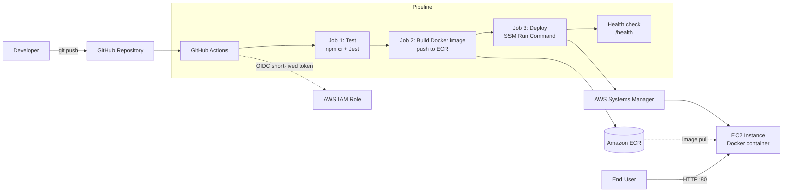

# Automated-CI-CD-Pipeline-with-GitHub-Actions-AWS
# CI/CD Pipeline with GitHub Actions on AWS


An end-to-end automated delivery pipeline: every push to `main` is tested, built into a Docker image, pushed to Amazon ECR, deployed to an EC2 instance, and verified with a health check. Authentication uses GitHub OIDC, so **no AWS access keys are stored anywhere**.


## Problem Statement

Manual deployments are slow, inconsistent, and error-prone. Developers copy files to servers by hand, skip tests under time pressure, and cannot easily roll back. Long-lived cloud credentials stored in CI systems are also a major security risk.

This project solves both problems by automating the full path from `git push` to a live, verified deployment, using short-lived credentials and least-privilege IAM permissions.

## Architecture



Add an exported image to `docs/architecture.png` (draw.io or Excalidraw) for extra polish. More detail is in [docs/architecture.md](docs/architecture.md).

## Tech Stack

| Layer | Tool |
|---|---|
| Application | Node.js 20, Express |
| Testing | Jest, Supertest |
| Containerization | Docker |
| CI/CD | GitHub Actions |
| Container registry | Amazon ECR |
| Hosting | Amazon EC2 (free tier) |
| Authentication | GitHub OIDC with an IAM role |
| Remote deploy | AWS Systems Manager (SSM) |

## Pipeline Stages

| Stage | Trigger | What it does |
|---|---|---|
| Test | Push and pull request | Installs dependencies and runs Jest tests |
| Build and push | Push to `main` | Builds the Docker image, tags it with the commit SHA, pushes to ECR |
| Deploy | After a successful build | Uses SSM to pull and run the new container on EC2 |
| Verify | After deploy | Calls `/health` with retries, fails the pipeline if unhealthy |

## Repository Structure

```
.
├── .github/workflows/ci-cd.yml    # Pipeline definition
├── app/                           # Node.js application and tests
├── docs/                          # Setup guide, architecture, screenshots, demo
├── infra/                         # IAM trust and permissions policy templates
├── Dockerfile
├── .dockerignore
└── .gitignore
```

## Prerequisites

- AWS account (free tier) with MFA enabled
- GitHub account
- Node.js 20 and Docker (for local testing)

## Run Locally

```bash
cd app
npm install
npm test
npm start          # http://localhost:3000
```

Or with Docker, from the repo root:

```bash
docker build -t cicd-demo-app .
docker run -p 3000:3000 cicd-demo-app
```

## Setup Instructions

Full step-by-step AWS instructions are in **[docs/setup.md](docs/setup.md)**. Summary:

1. Create an ECR repository named `cicd-demo-app`.
2. Launch an EC2 instance, install Docker, attach an SSM and ECR read-only instance role.
3. Create the GitHub OIDC provider and an IAM role (templates in `infra/`).
4. Add the GitHub repository secrets below.
5. Push to `main` and watch the **Actions** tab.

## Required GitHub Secrets

| Secret | Purpose |
|---|---|
| `AWS_ROLE_ARN` | ARN of the IAM role GitHub Actions assumes via OIDC |
| `EC2_INSTANCE_ID` | Target EC2 instance ID (for SSM) |
| `EC2_PUBLIC_IP` | Public IP used by the health check |

## Security Practices

- No access keys: short-lived credentials through OIDC
- Role trust policy restricted to this repository and the `main` branch
- Least-privilege IAM (ECR push to one repo, SSM to one instance)
- No SSH port open; deployments go through SSM
- Container runs as a non-root user
- `.gitignore` blocks `.env`, `*.pem`, `*.tfstate`

## Screenshots and Demo

| Item | File |
|---|---|
| Successful pipeline run | `docs/pipeline-success.png` |
| Live application | `docs/app-live.png` |
| Demo GIF (push, pipeline, live update) | `docs/demo.gif` |

## Cost and Cleanup

Designed to stay within the AWS free tier. Set an AWS Budget alert on day one. When finished:

1. Terminate the EC2 instance
2. Delete the ECR repository
3. Release any Elastic IP
4. Delete the IAM role and OIDC provider

## Future Improvements

- Provision infrastructure with Terraform
- Add Trivy vulnerability scanning for the image
- Separate staging and production with manual approval
- Blue/green deployment and automatic rollback
- Slack or Telegram failure notifications

## Author

**Your Name** | B.Tech CSE (Cloud Computing)
[LinkedIn](https://linkedin.com/in/your-profile) | [GitHub](https://github.com/<GITHUB_USERNAME>)

**Certifications:** AWS Certified Cloud Practitioner (in progress / add credential link)

## License

MIT
