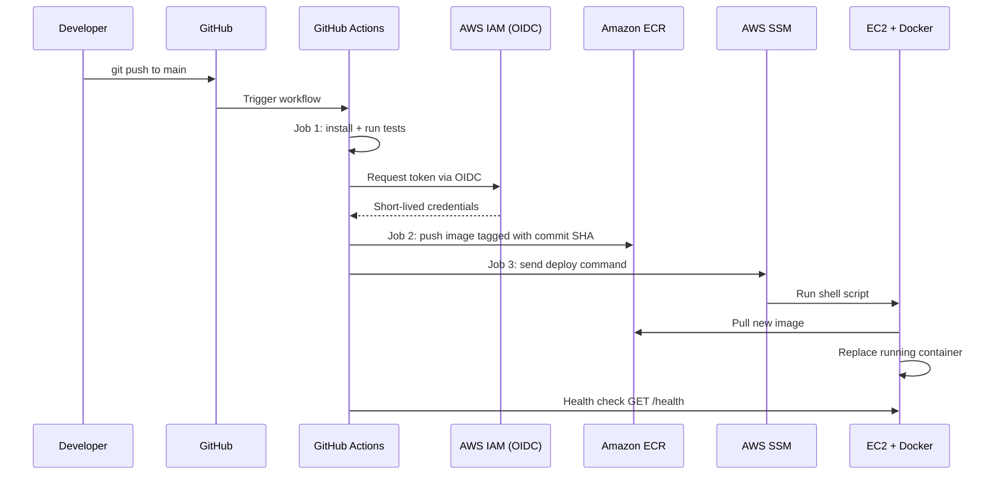

# Architecture

## Flow

## Design decisions

| Decision | Reason |
|---|---|
| OIDC instead of access keys | Credentials are short-lived and never stored in GitHub |
| Image tagged with commit SHA | Every deployment is traceable and rollback is easy |
| SSM instead of SSH | No open SSH port, no key management, all commands are audited |
| Health check at the end | Pipeline fails if the new version is not actually serving traffic |
| Non-root container user | Reduces the impact of a container compromise |

## Diagram assets

Export a draw.io or Excalidraw version of this diagram as `docs/architecture.png`.
